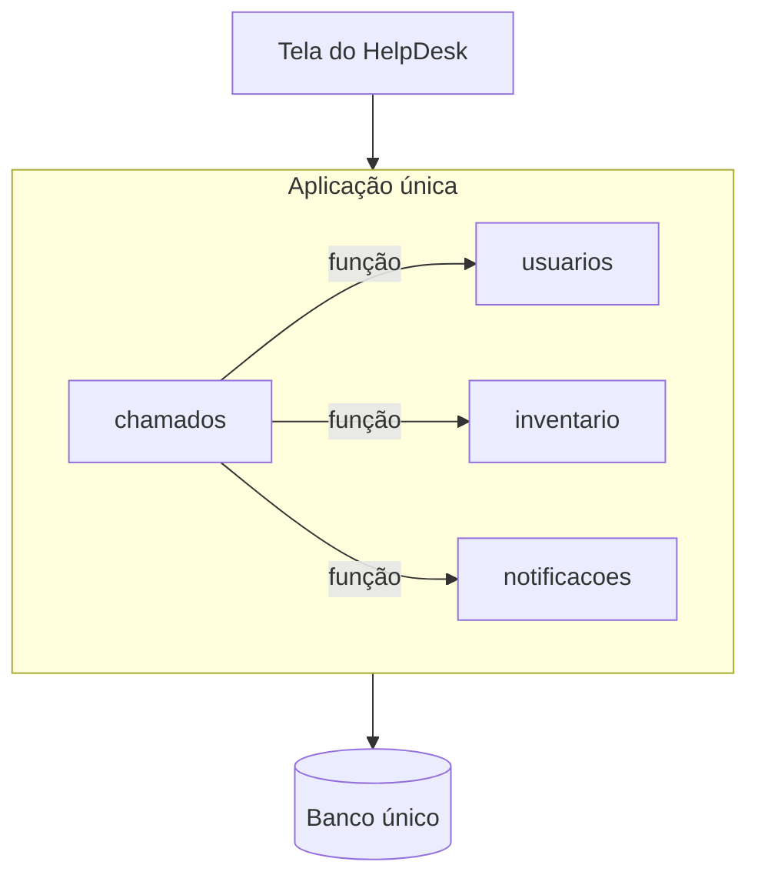
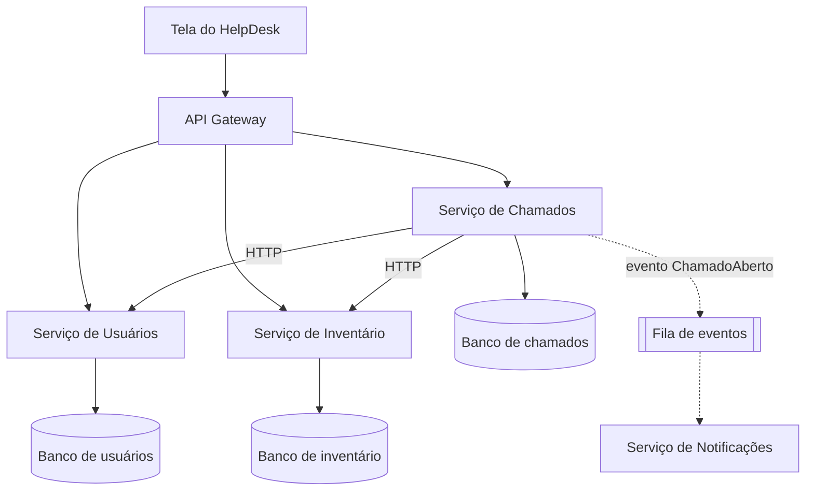

# Desafio: do monólito aos microsserviços

**Disciplina:** Arquitetura de Software · **Prof. Filipe Cavalcante**
**Modalidade:** individual

## A missão

O **HelpDesk TI** funciona, mas é um **monólito**: uma aplicação, um banco e uma implantação.
A empresa cresceu e cada parte do sistema passou a ter um time próprio. A sua missão é
**transformar o HelpDesk em microsserviços**, sem perder nenhuma funcionalidade.

## Como começar

1. No topo deste repositório, clique em **Use this template → Create a new repository**.
2. Crie o repositório na **sua conta**, **público**, com o nome `helpdesk-microsservicos-<seu-nome>`.
3. Rode o monólito antes de mudar qualquer coisa (veja o [README](README.md)) e conheça as telas e as rotas.

## Onde está hoje (monólito)

## Aonde você deve chegar

As linhas tracejadas são o **bônus**.

## Requisitos obrigatórios

1. **Três serviços separados:** Usuários, Inventário e Chamados. Cada um é um projeto próprio, roda no seu próprio contêiner e pode ser iniciado sozinho.
2. **Um banco por serviço:** nenhum serviço lê ou grava no banco de outro. As chaves estrangeiras entre tabelas de serviços diferentes deixam de existir.
3. **Comunicação pela rede:** o serviço de Chamados confere o solicitante, o técnico e o equipamento chamando os outros serviços por HTTP (por exemplo, `GET /usuarios/{id}`).
4. **Tratamento de falhas:** se Usuários ou Inventário estiverem fora do ar, Chamados responde com um erro claro (por exemplo, 503) em vez de travar. Use um tempo limite (`timeout`) nas chamadas.
5. **API Gateway:** um único ponto de entrada (porta 8000) que encaminha cada rota para o serviço certo. A tela do HelpDesk deve continuar funcionando por ele, sem mudar o endereço.
6. **Tudo sobe com um comando:** `docker compose up --build` inicia todos os serviços, bancos e o gateway.
7. **Mesmas funcionalidades:** abrir, atribuir, mudar status, comentar e ver o painel continuam funcionando, com as mesmas regras (SLA e transições de status).
8. **README do projeto:** diagrama da nova arquitetura em Mermaid, como rodar e as decisões que você tomou.

## Bônus

- **Notificações por evento:** o serviço de Chamados publica os eventos `ChamadoAberto`, `ChamadoAtribuido` e `ChamadoResolvido` em uma fila (por exemplo, Redis ou RabbitMQ). Um serviço de **Notificações** consome esses eventos e grava os avisos. Se Notificações cair, os chamados continuam sendo abertos.
- **Testes por serviço:** cada serviço com seus próprios testes, rodando no GitHub Actions.
- **Rota de saúde:** cada serviço com `GET /saude`, e o gateway mostrando quais serviços estão no ar.

## Dicas

- Procure no código os comentários `# vira chamada HTTP` e `# vira evento` em `app/chamados/servico.py`. Eles marcam exatamente os pontos que mudam.
- Cada módulo já tem uma porta pública (`servico.py`). Comece separando o módulo que **não depende de ninguém** (Usuários ou Inventário).
- Separe um serviço por vez e teste a cada passo. Não tente separar tudo de uma vez.
- Para o gateway, pode ser um pequeno projeto FastAPI que repassa as requisições com `httpx`, ou um Nginx.
- Dentro do Docker Compose, os serviços se chamam pelo nome (por exemplo, `http://usuarios:8000`), não por `localhost`.

## O que o professor vai analisar

| Item | O que será observado |
|---|---|
| Separação | Três serviços independentes, cada um com seu banco |
| Comunicação | Chamadas HTTP entre serviços, com timeout e tratamento de falha |
| Gateway | Ponto único de entrada; a tela funciona por ele |
| Execução | `docker compose up --build` sobe tudo sem ajustes manuais |
| Funcionalidades | Fluxo completo de um chamado funcionando |
| Documentação | README com diagrama, instruções e decisões |
| Histórico | Commits ao longo do trabalho, um serviço por vez, com mensagens claras |
| Bônus | Eventos, testes por serviço e rota de saúde |

## Entrega

Envie ao professor o **link do seu repositório**, no prazo combinado em aula.
