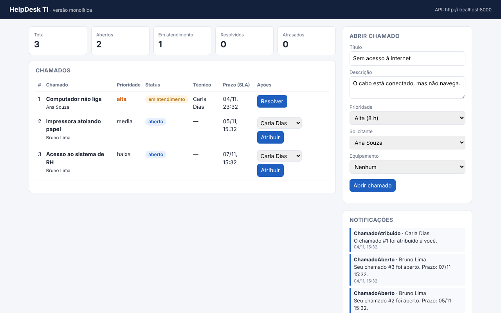
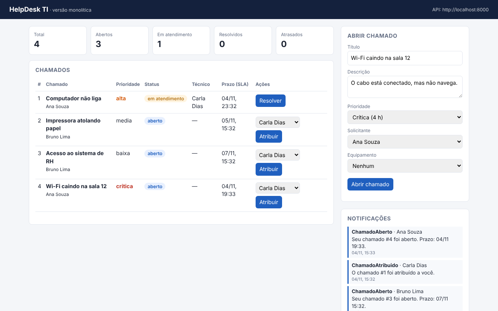
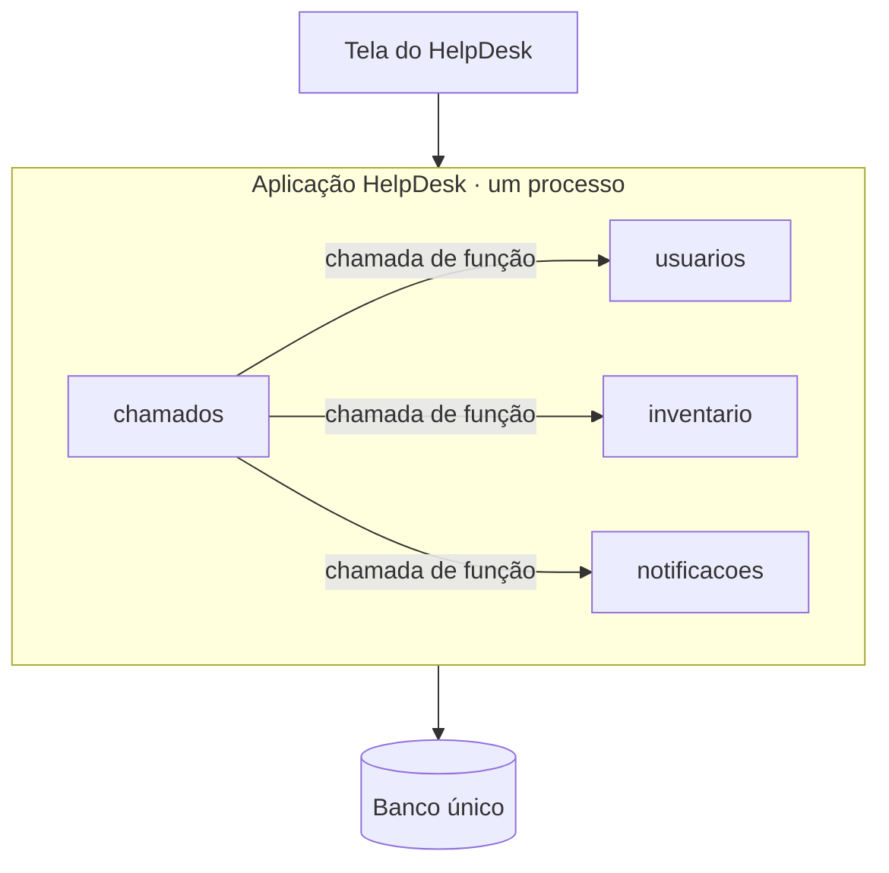

# HelpDesk TI · versão monolítica

Sistema de chamados de TI (no estilo de um GLPI simplificado), feito em **Python + FastAPI**.
É a aplicação base da atividade de **Arquitetura de Software**: hoje ela é um **monólito**;
a missão da turma é transformá-la em **microsserviços** (veja [DESAFIO.md](DESAFIO.md)).

## Telas do sistema


| Painel inicial | Chamado aberto | Chamado resolvido |
|---|---|---|
|  |  |  |

## O que o sistema faz

- Cadastra **usuários** (solicitantes e técnicos) e **equipamentos** (inventário de TI).
- **Abre chamados** com prioridade e calcula o prazo de atendimento (SLA): crítica 4 h, alta 8 h, média 24 h, baixa 72 h.
- **Atribui** chamados a técnicos, controla o **status** e aceita **comentários**.
- Registra **notificações** quando um chamado é aberto, atribuído ou resolvido.
- Mostra um **painel** com totais por status e chamados atrasados.

## Como rodar

**Com Docker**

```bash
docker compose up --build
```

**Sem Docker** (Python 3.11 ou mais novo)

```bash
pip install -r requirements.txt
uvicorn app.main:app --reload
```

Depois abra:

- Tela do HelpDesk: http://localhost:8000
- Documentação da API (Swagger): http://localhost:8000/docs

O sistema já começa com usuários, equipamentos e chamados de exemplo.

## Testes

```bash
pytest -q
```

## Arquitetura atual (monólito)

Uma aplicação, um banco e uma implantação. O código é dividido em **módulos**, e cada módulo
só usa a **porta pública** do outro (o arquivo `servico.py`).



```
app/
├── main.py            # junta os módulos e sobe a aplicação
├── database.py        # conexão com o banco único
├── erros.py           # erros de negócio
├── dados_exemplo.py   # dados iniciais
├── web/index.html     # tela simples que usa a API
├── usuarios/          # modelos, esquemas, repositorio, servico (público), rotas
├── inventario/
├── chamados/          # depende de usuarios, inventario e notificacoes
└── notificacoes/
```

Em `app/chamados/servico.py`, os comentários `# vira chamada HTTP` e `# vira evento` marcam
os pontos que mudam quando o sistema for separado.

## Rotas principais

| Método | Rota | O que faz |
|---|---|---|
| POST / GET | `/usuarios` | Cria e lista usuários |
| POST / GET | `/ativos` | Cria e lista equipamentos |
| POST / GET | `/chamados` | Abre e lista chamados |
| GET | `/chamados/painel` | Totais por status e atrasados |
| PATCH | `/chamados/{id}/atribuir` | Atribui a um técnico |
| PATCH | `/chamados/{id}/status` | Muda o status |
| POST | `/chamados/{id}/comentarios` | Comenta no chamado |
| GET | `/notificacoes` | Lista notificações |
