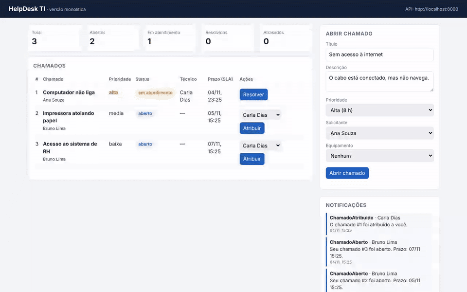
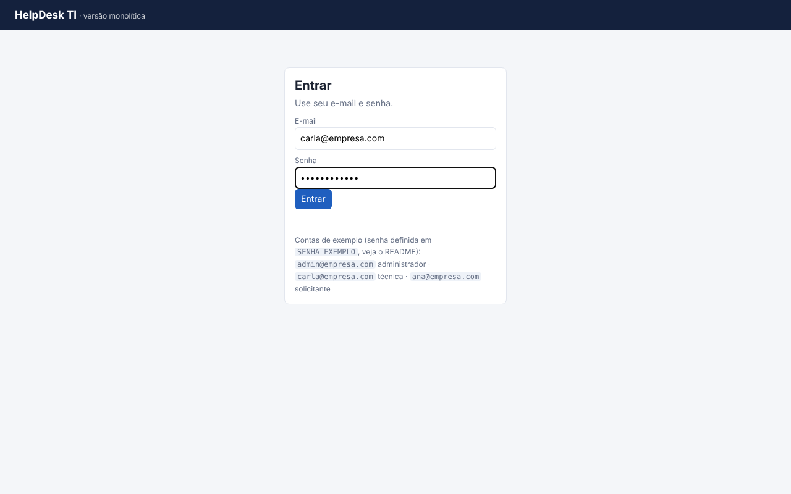
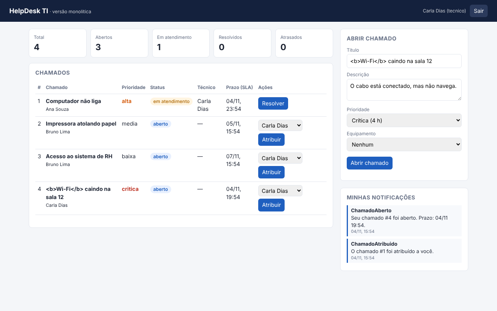
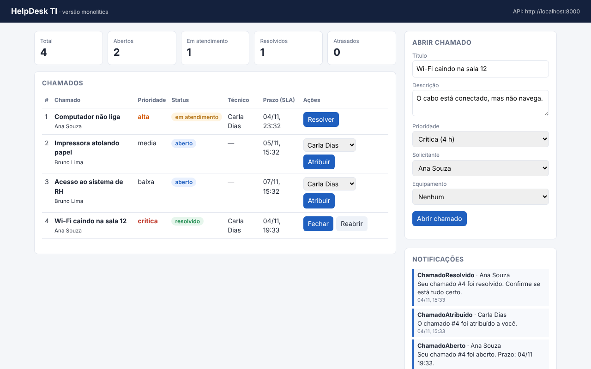
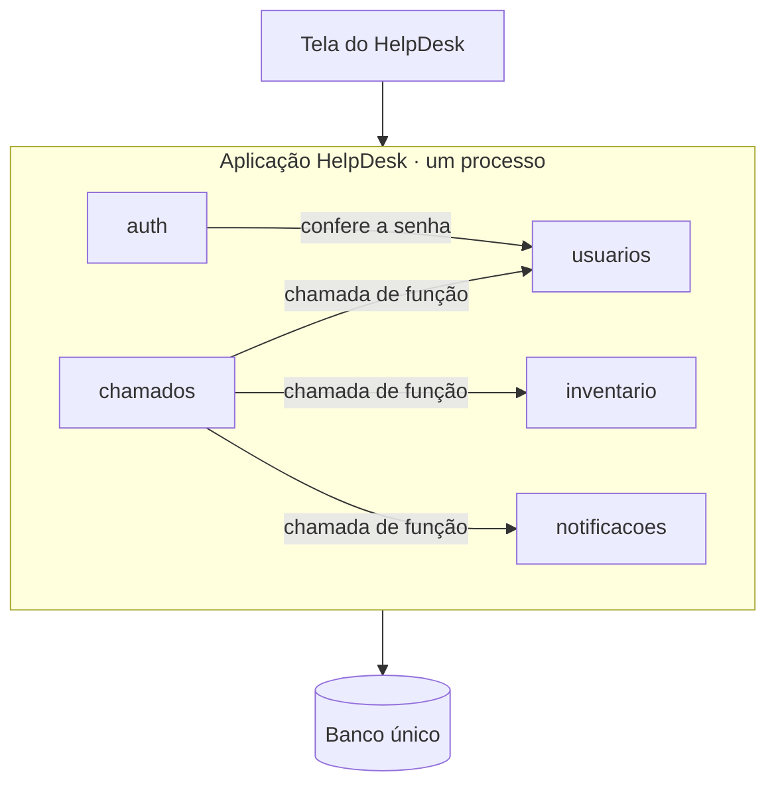

# HelpDesk TI · versão monolítica

Sistema de chamados de TI (no estilo de um GLPI simplificado), feito em **Python + FastAPI**.
É a aplicação base da atividade de **Arquitetura de Software**: hoje ela é um **monólito**;
a missão de cada aluno é transformá-la em **microsserviços** (veja [DESAFIO.md](DESAFIO.md)).

## Telas do sistema



| Login | Painel do técnico | Chamado resolvido |
|---|---|---|
|  |  |  |

## O que o sistema faz

- **Login** com e-mail e senha; cada pessoa vê e faz só o que o seu perfil permite.
- Cadastra **usuários** e **equipamentos** (inventário de TI).
- **Abre chamados** com prioridade e calcula o prazo de atendimento (SLA): crítica 4 h, alta 8 h, média 24 h, baixa 72 h.
- **Atribui** chamados a técnicos, controla o **status** e aceita **comentários**.
- Registra **notificações** quando um chamado é aberto, atribuído ou resolvido.
- Mostra um **painel** com totais por status e chamados atrasados.

### Perfis e permissões

| Ação | Solicitante | Técnico | Administrador |
|---|:-:|:-:|:-:|
| Abrir chamado | ✅ | ✅ | ✅ |
| Ver chamados | só os seus | todos | todos |
| Comentar | nos seus | todos | todos |
| Atribuir e resolver | ❌ | ✅ | ✅ |
| Fechar ou reabrir um chamado resolvido | os seus | ✅ | ✅ |
| Cadastrar equipamentos | ❌ | ✅ | ✅ |
| Cadastrar usuários | ❌ | ❌ | ✅ |

## Como rodar

**Com Docker**

```bash
docker compose up --build
```

**Sem Docker** (Python 3.11 ou mais novo)

```bash
pip install -r requirements-dev.txt
uvicorn app.main:app --reload
```

Depois abra:

- Tela do HelpDesk: http://localhost:8000
- Documentação da API (Swagger): http://localhost:8000/docs (clique em **Authorize** e cole o token do login)

### Contas de acesso

Não é preciso criar conta: o sistema já começa com estes usuários.
Todos usam a senha **`Helpdesk2026`**.

| E-mail | Perfil | O que pode fazer |
|---|---|---|
| `admin@empresa.com` | Administrador | Tudo, inclusive cadastrar usuários |
| `carla@empresa.com` | Técnica | Ver todos os chamados, atribuir, resolver e cadastrar equipamentos |
| `diego@empresa.com` | Técnico | O mesmo que a Carla |
| `ana@empresa.com` | Solicitante | Abrir chamados e ver só os próprios |
| `bruno@empresa.com` | Solicitante | O mesmo que a Ana |

Dicas:

- Para testar o fluxo completo (abrir, atribuir, resolver e fechar), entre como **Carla**.
- Para testar as permissões, entre como **Ana**: ela não vê os chamados do Bruno.
- Para trocar a senha de todas as contas, defina `SENHA_EXEMPLO` no arquivo `.env`.
- As contas só são criadas quando o sistema sobe com `DADOS_EXEMPLO=1` (o padrão), e só na primeira vez, com o banco vazio.

> Estas contas têm senha conhecida e servem só para aula. Em produção, use `DADOS_EXEMPLO=0`.

### Configuração

Copie `.env.example` para `.env` e ajuste. O principal é o `JWT_SEGREDO`, que assina os logins.
O arquivo `.env` nunca deve ir para o GitHub (ele já está no `.gitignore`).

## Testes

```bash
pytest -q
```

São 36 testes, incluindo **testes de segurança** (`tests/test_seguranca.py`): login, token falso ou vencido,
bloqueio de tentativas, permissões por perfil, campos extras e limites de tamanho.
A cada envio ao GitHub, os testes rodam sozinhos e o `pip-audit` confere se alguma dependência tem falha conhecida.

## Segurança

Veja o que está protegido e o que fazer antes de usar em produção em [SECURITY.md](SECURITY.md).

## Arquitetura atual (monólito)

Uma aplicação, um banco e uma implantação. O código é dividido em **módulos**, e cada módulo
só usa a **porta pública** do outro (o arquivo `servico.py`).



```
app/
├── main.py            # junta os módulos e sobe a aplicação
├── config.py          # configurações (variáveis de ambiente)
├── database.py        # conexão com o banco único
├── seguranca_http.py  # cabeçalhos de segurança e limite de tamanho
├── erros.py           # erros de negócio
├── dados_exemplo.py   # dados iniciais (só para aula)
├── web/               # tela: index.html, app.js, estilo.css
├── auth/              # senhas (scrypt), tokens JWT, login, limite de tentativas
├── usuarios/          # modelos, esquemas, repositorio, servico (público), rotas
├── inventario/
├── chamados/          # depende de usuarios, inventario e notificacoes
└── notificacoes/
```

Em `app/chamados/servico.py`, os comentários `# vira chamada HTTP` e `# vira evento` marcam
os pontos que mudam quando o sistema for separado.

## Rotas principais

Todas exigem login, exceto `/auth/login` e `/saude`.

| Método | Rota | O que faz | Quem pode |
|---|---|---|---|
| POST | `/auth/login` | Entra e recebe o token | Todos |
| GET | `/auth/eu` | Dados de quem está logado | Logado |
| POST | `/usuarios` | Cria usuário | Admin |
| GET | `/usuarios` | Lista usuários (sem e-mail) | Logado |
| POST / GET | `/ativos` | Cria e lista equipamentos | Técnico e admin / logado |
| POST | `/chamados` | Abre chamado em nome de quem está logado | Logado |
| GET | `/chamados` | Lista chamados | Logado (solicitante vê só os seus) |
| GET | `/chamados/painel` | Totais por status e atrasados | Logado |
| PATCH | `/chamados/{id}/atribuir` | Atribui a um técnico | Técnico e admin |
| PATCH | `/chamados/{id}/status` | Muda o status | Técnico e admin (solicitante: fechar ou reabrir) |
| POST | `/chamados/{id}/comentarios` | Comenta no chamado | Envolvidos |
| GET | `/notificacoes` | Minhas notificações | Logado |
